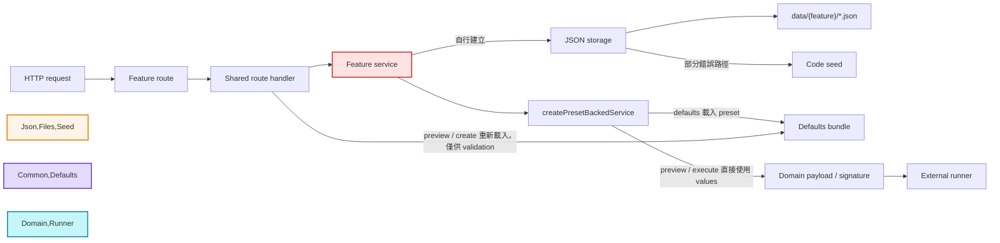
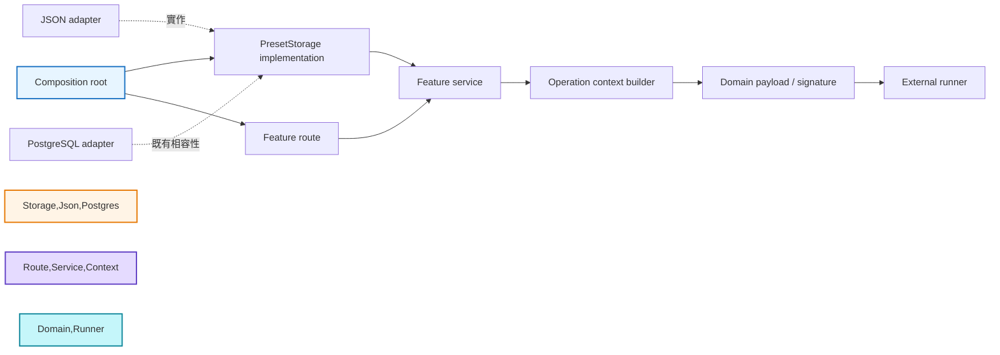
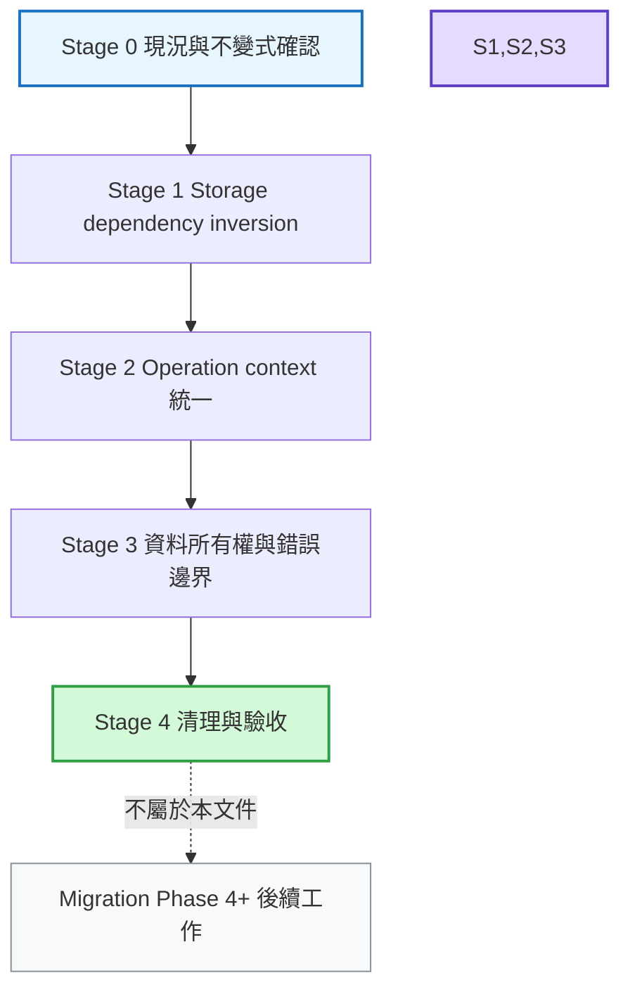

# Phase 3 後端資料流技術債與解耦設計書

## 文件定位

- 文件等級：完整開發設計書。
- 文件狀態：草稿，待設計確認後才進入實作。
- 生成日期：2026-11-13。
- 審閱基準：Preset database migration Phase 3 完成後的現有程式碼。
- 主要範圍：後端 preset 資料流、domain／service／route 責任、storage 依賴方向、重複業務資料與錯誤邊界。
- 主要規範：[AGENTS.md](../../AGENTS.md)。
- 歷史設計：[2026-10-22-preset-database-migration.md](2026-10-22-preset-database-migration.md)。

本文件的目的，是審閱 Phase 3 完成後的實際程式碼，找出會增加維護成本、資料不一致風險或測試困難的耦合，並提出最小、可分階段、可驗證的改善方案。

既有 migration 設計只提供已確認的不變式與歷史脈絡，不是本文件的完成清單。本文件不要求一併完成該設計的 Phase 4 至 Phase 8，也不以 importer、Supabase rollout 或 production cutover 作為本次解耦完成條件。

本文件只描述設計。現況尚未達成本文件的解耦目標；是否完成必須依「完成定義」逐項驗收。

## 設計用語

| 用語 | 定義 |
| --- | --- |
| 唯一資料來源 | 一項可變業務事實的唯一權威來源。其他位置只能保存投影、schema、protocol constant 或測試 fixture。 |
| 持久化投影 | 可由 storage 讀寫的 preset 資料，不包含一次操作才產生的暫時狀態。 |
| 暫時操作狀態 | 只在單次 request 或目前頁面操作中存在，不寫入 JSON、PostgreSQL 或 session storage 的資料。 |
| Operation context | 一次 defaults、preview 或 create 所使用的已解析 preset、環境設定與 request input。 |
| Composition root | 建立 service、storage、route 與生命週期依賴的應用程式組裝入口。 |
| 技術債 | 已由目前程式碼證實，並會造成重複修改、責任混淆、錯誤被隱藏或測試成本增加的結構問題。 |

## 1. 背景與目前程式碼證據

既有 migration 設計的 Phase 1、Phase 2、Phase 3 已完成 storage boundary、database lifecycle、PostgreSQL adapter 與 repository integration tests。正式 API runtime 尚未切換至 PostgreSQL，這是既有 migration 設計的後續工作，不是本文件必須完成的目標。

目前程式碼顯示以下技術債：

1. `createDepositService`、`createPayoutService` 與 `createSubscriptionService` 各自在 feature service 內建立 JSON storage，service 同時負責業務流程與 adapter 選擇。
2. `handlePresetBackedRoute` 會為 preview／create 重新載入 defaults bundle 進行 validation，但 `createPresetBackedService` 的 `preview` 與 `execute` 仍直接使用 caller 傳入的 values。已載入的 bundle 沒有成為共用的 operation context。
3. feature `presets.ts` 同時包含 schema、seed、normalize、projection、JSON IO 與 response mapping，修改資料格式時容易牽動多種責任。
4. 可變業務值散落於 `data/**/*.json`、feature seed 與 domain template／fallback，來源所有權不清楚。
5. 部分 JSON 讀取路徑會把讀取或解析失敗視為缺檔，再回退到 seed，可能隱藏損壞資料。
6. 部分 domain 依賴 feature transport type，資料方向由外層 transport 反向流入核心業務層。
7. channel、token environment key、data filename、audit target 與 frontend label 由多處維護，新增 channel 時需要人工同步。

PostgreSQL adapter 已證明 storage contract 可以有第二種實作，但目前沒有 production caller。這項事實可用來驗證依賴邊界是否足夠，不代表本文件要求立即切換 runtime。

## 2. 與既有 migration 設計的關係

### 2.1 本文件沿用的不變式

| 已確認的不變式 | 本文件如何沿用 |
| --- | --- |
| `preset_store` schema 與現有 migration 不重做 | 解耦不得自行更改 schema 或資料庫 key。 |
| `merchantRef`／`merchantReference` 是 runtime-only | storage projection、save 與 export 不得持久化這些欄位。 |
| PostgreSQL save 使用 transaction 與 `updated_at` concurrency | storage interface 不得破壞既有 conflict 語意。 |
| JSON 與 PostgreSQL 實作相同 storage boundary | feature service 依賴 contract，不依賴具體 adapter。 |
| API path、上游 payload key 與簽名規則保持相容 | 解耦只調整內部責任，不改公開行為。 |
| DB unavailable 不得靜默 fallback 至 JSON | 未來若由 migration 工作切換 adapter，錯誤仍須 fail closed。 |

### 2.2 不屬於本文件完成條件的後續工作

下列項目仍由既有 migration 設計管理，除非實作解耦時發現它們是直接前置條件，否則不納入本次範圍：

- Phase 4 importer、checksum、全量 parity 與 readiness report。
- JCB invalid JSON 的資料修復或移除決策。
- Phase 5 本機 PostgreSQL runtime cutover。
- Phase 6 Supabase staging 與 remote migration。
- Phase 7 最終資料驗收。
- Phase 8 production cutover、監控與 JSON runtime 退場。
- PostgreSQL 切換後的 export、backfill 與 production rollback 演練。

本文件可以讓後續 migration 工作更容易接入，但不能用「為未來 migration 預作準備」為理由增加目前沒有實際 consumer 的 framework、public API 或抽象層。

## 3. 目標

完成後應達到以下可驗證結果：

1. feature service 不再自行決定使用哪一個 storage adapter，而是接受 composition root 注入的 `PresetStorage`。
2. defaults、preview 與 create 對 preset 的載入、合併與 validation 有單一且可追蹤的 operation context；相同輸入不會因路徑不同而使用不同來源。
3. 可變業務值、protocol constant、environment secret、runtime-only value 與測試 fixture 有明確且唯一的責任層。
4. JSON 的 not found、invalid data 與 IO unavailable 有不同語意；資料損壞或權限錯誤不得被 seed fallback 隱藏。
5. domain 擁有業務 input、payload 與簽名型別，不反向依賴 route 或 feature transport module。
6. channel metadata 由單一 backend manifest 或同等的單一資料結構推導，避免多份平行清單。
7. 保留現有 API path、request／response 必要欄位、上游 payload key、簽名與 merchant non-persistence 行為。
8. 每項被處理的技術債都有對應的 `Risk → Test → Test layer`，並以最低但足夠的層級驗證。

## 4. 非目標

- 不要求完成既有 migration 設計的 Phase 4 至 Phase 8。
- 不要求將 production runtime 從 JSON 切換為 PostgreSQL。
- 不建立 importer、readiness report、Supabase deployment 或 production rollback 流程。
- 不新增公開 preset save API。若產品需要 operator 編輯入口，應另行確認 auth、API 與 frontend contract。
- 不新增交易紀錄、付款嘗試、webhook event、背景任務或 queue。
- 不引入 ORM、generic repository framework、DI container、service locator 或 message broker。
- 不重寫 Deposit、Payout、Subscription 的全部 domain；只調整有現況證據且能降低技術債的邊界。
- 不把所有 literal 都移出程式碼。API path、payload key、簽名欄位與固定 protocol value 可以保留為程式碼常數。
- 不把 API key、sign key、merchant token 或其他 secret 寫入 preset storage。
- 不為了形式上的一致性建立沒有實際 consumer 的 helper、wrapper 或共用模組。

## 5. 現況資料流與耦合位置



目前最主要的問題不是 PostgreSQL 尚未接入，而是 service 選擇 storage、操作路徑沒有共用 context，以及業務資料所有權分散。若直接在這個結構加入 runtime driver，會把既有耦合帶入下一階段。

## 6. 技術債優先級

| 優先級 | 技術債 | 目前風險 | 本次處置 |
| --- | --- | --- | --- |
| P0 | Feature service 建立 JSON adapter | 業務流程與基礎設施耦合，替換 adapter 需修改三個 service | 將 `PresetStorage` 由 composition root 注入 |
| P0 | JSON 錯誤靜默回退 seed | 損壞或不可讀資料看似成功，診斷與驗收失真 | 區分 not found、invalid、unavailable；runtime fail closed |
| P1 | defaults 與 preview／create 資料路徑分離 | UI 顯示的 defaults 不一定是操作實際使用的資料 | 建立單一 hydrate／merge／validate operation context |
| P1 | `presets.ts` 責任過多 | schema、IO 與 mapping 互相牽動，修改與測試範圍過大 | 依現有責任拆成 definition、mapper 與 adapter callback |
| P1 | 可變業務值多處保存 | product number、amount 或 channel config 漂移 | 建立 data ownership matrix，移除 domain 的第二份 mutable default |
| P1 | Domain 依賴 transport type | 核心邏輯被外層 module 形狀限制 | 將業務 type 移至 domain 或純共享 type，transport 只做轉換 |
| P2 | Channel metadata 平行清單 | 新 channel 容易漏改 token、filename 或 audit target | 建立純 TypeScript canonical manifest |
| P2 | Target environment policy 隱藏 | `local` 與 request target 的用途混淆 | 明確區分 preset scope 與 environment／secret resolution |

P0 與 P1 是本文件的主要完成範圍。P2 只有在能移除目前已存在的重複資料時才實作，不為未來需求預先擴張。

## 7. 設計原則與資料所有權

### 7.1 一個業務事實只能有一個責任層

| 資料類型 | 例子 | 權威來源 | 可否持久化 |
| --- | --- | --- | --- |
| Protocol constant | payload key、簽名欄位、HTTP path | domain／route contract | 否 |
| Channel metadata | channel id、filename、token env key、default channel | backend manifest | 否 |
| Schema／validation | type、required、readonly、cross-field rule | feature definition／validator | 否 |
| Persistent preset | product number、amount、currency、return URL、channel payload | storage projection | 是 |
| Environment secret | API key、sign key、base URL | env／config registry | 否 |
| Runtime-only value | merchant reference、request id、preview context | operation context | 否 |
| Test fixture | 測試金額、sample payload | test fixture | 否 |

### 7.2 合併順序必須集中

若一次操作需要組合多個來源，合併順序固定在 operation context builder，domain 不得再補第二套 mutable fallback：

```text
persistent preset
  → request input
  → server-owned runtime value
  → validation
  → domain payload and signature
```

- Persistent preset 提供儲存中的預設值。
- Request input 只能覆蓋 API contract 允許 caller 提供的欄位。
- Server-owned runtime value 最後套用，caller 不得覆蓋 merchant reference、request id 或 secret。
- Validation 必須在完成合併後執行。
- Domain 接收完整且已驗證的 typed context，不自行讀 storage 或 environment。

### 7.3 Runtime 不做靜默 fallback

允許 seed 的位置：

- bootstrap 或 importer。
- 明確注入 seed 的單元測試。
- 建立全新 fixture 時的初始化流程。

不允許 seed 的位置：

- JSON parse error。
- filesystem permission 或 IO error。
- PostgreSQL unavailable。
- 單一 channel 讀取失敗。

缺檔是否可由 seed 初始化，必須由明確的 bootstrap path 決定，不能由一般 request load 隱式決定。

## 8. 目標依賴方向



### 8.1 分層責任

| Layer | 負責 | 不負責 |
| --- | --- | --- |
| Composition root | 建立目前選定的 storage、service、route 與必要 lifecycle | preset merge、payload rule、SQL |
| Route | HTTP parse、status、error envelope、呼叫 service | file IO、SQL、簽名、channel business rule |
| Feature service | 協調 load、hydrate、validate、preview、create | 建立具體 storage、HTTP response construction |
| Operation context builder | 合併 preset、request、runtime-owned value 並驗證 | IO、runner call、HTTP |
| Preset definition／mapper | schema、projection、persistent／transient mapping | storage lifecycle、HTTP |
| Storage contract | load／save snapshot 與 concurrency 語意 | feature schema、merchant policy、HTTP status |
| JSON／PostgreSQL adapter | 實作持久化與 typed storage error | seed fallback、route contract、domain payload |
| Domain | typed business input、payload、signature、server-owned field rule | storage、filesystem、route、transport type |
| Runner | 呼叫 upstream 並分類 upstream error | preset merge、UI state |

### 8.2 Storage 注入邊界

本次只要求 composition root 能將 `PresetStorage` 注入 feature service，預設仍可建立 JSON adapter。既有 PostgreSQL adapter 可作為 contract compatibility 的第二個實作證據，但啟用哪個 runtime driver 仍由 migration Phase 5 決定。

不得為此引入 DI container。使用既有 factory options 或明確 constructor parameter 即可。

## 9. 分階段實作



| Stage | 主要變更 | Exit gate |
| --- | --- | --- |
| Stage 0：現況確認 | 固定 API、payload、signature、merchant non-persistence 與 storage conflict 等不變式；列出實際重複資料 | 每個要處理的技術債都有程式碼證據、風險與 owner |
| Stage 1：Storage dependency inversion | feature service 接受 storage；composition root 建立 JSON storage；保留既有行為 | 三個 service 不再 import／建立具體 JSON adapter；API contract tests 通過 |
| Stage 2：Operation context 統一 | 集中 preset load、merge、runtime-owned value 與 validation | defaults、preview、create 的資料來源與優先序可由 service tests 證明 |
| Stage 3：所有權與錯誤邊界 | 拆分必要的 definition／mapper；移除 domain mutable fallback；區分 storage error；建立必要 manifest | 損壞資料不 fallback；domain 不依賴 transport；重複業務事實只有一個來源 |
| Stage 4：清理與驗收 | 移除已無 caller 的兼容分支與重複清單；執行適用 gate | 完成定義全部有證據，公開契約沒有非預期變化 |

每個 Stage 都可獨立提交。若某項修改會改變 API、資料格式、schema 或業務語意，停止受影響路徑並先取得確認；不受影響的邊界整理可以繼續。

## 10. 影響矩陣

| 區域 | 目前行為 | 目標行為 | 相容策略 |
| --- | --- | --- | --- |
| Feature service | 自行建立 JSON storage | 接受 storage contract | 預設仍注入 JSON adapter，operation 名稱不變 |
| Defaults／preview／create | defaults 載入 preset；preview／create 直接使用 caller values | 共用明確的 operation context 與合併順序 | 保留 request／response 必要欄位 |
| Preset module | schema、seed、IO、projection 混合 | 只拆分有獨立責任與測試邊界的部分 | 不一次重寫全部 feature |
| JSON load | 部分錯誤可能回退 seed | typed not found／invalid／unavailable | 缺檔初始化改走明確 bootstrap |
| Domain | 含 mutable fallback，部分依賴 transport type | 只保留業務 payload、signature 與 protocol rule | 上游 key 與簽名不變 |
| Channel metadata | 多份平行清單 | 單一 backend manifest 推導 | frontend label 可維持 UI-owned，但 channel id 必須 parity |
| PostgreSQL adapter | 已存在但未接 runtime | 保持 storage contract 相容 | 本文件不啟用 production driver |
| API route | 轉送 service 與錯誤 | 維持薄 route，補 storage error mapping | route path、method 與 error envelope 相容 |

## 11. 錯誤語意

| 類型 | 語意 | HTTP 邊界 |
| --- | --- | --- |
| preset not found | 明確不存在，是否初始化由 bootstrap 決定 | 依既有 contract 映射，不在 adapter 假裝成功 |
| preset invalid | JSON／row 無法通過格式或 projection 驗證 | 500 或既有 configuration error，不回 seed |
| storage unavailable | filesystem、permission、connection 或 timeout | 503 或既有 dependency error |
| preset conflict | caller 使用過期 snapshot | 沿用既有 `409 PRESET_CONFLICT` 語意 |
| validation error | 合併後的 operation context 不符合輸入規則 | 400 與既有 validation envelope |
| upstream error | runner 呼叫失敗或回傳非預期結果 | 沿用 runner 與 `AppError` mapping |
| unexpected error | 未分類內部錯誤 | 500，不暴露 path、SQL、token 或 payload secret |

Adapter error 不得直接穿過 route。實作前應對照 `src/server/errors.ts` 的現有 error code，避免為相同語意建立第二套錯誤名稱。

## 12. `Risk → Test → Test layer`

| Risk | Test | Test layer |
| --- | --- | --- |
| service 仍綁定具體 JSON adapter | 以 fake `PresetStorage` 建立三個 feature service，證明操作不需要 filesystem | service unit |
| defaults 與 preview／create 使用不同資料來源 | 注入一份 preset snapshot 與 request override，驗證三條路徑使用相同合併規則 | service / API boundary |
| caller 覆蓋 server-owned merchant value | 傳入 legacy merchant 欄位，驗證 operation context 與 final payload 採用 server-owned value | service / domain |
| merchant runtime data 被持久化 | JSON 與既有 PostgreSQL round-trip 均不含 merchant 欄位 | storage unit / DB integration |
| JSON parse 或 IO error 被當成缺檔 | 分別模擬 invalid、permission 與 not found，驗證只有明確 bootstrap 可使用 seed | storage unit |
| domain 保留第二份 mutable business default | 修改唯一 preset source，驗證 domain output 跟隨 context，且沒有隱式 fallback | domain / service |
| domain 反向依賴 transport | type check 與 import boundary 檢查；domain tests 不需要 route／web module | type check / static boundary |
| channel metadata 漂移 | 從 manifest 推導 channel、token key、filename 與 audit target，驗證 id 唯一且 parity | pure function / core |
| 解耦改變 API 或簽名 | 代表性 defaults、preview、create API tests 與 domain signature tests 維持既有輸出 | API route / domain |
| PostgreSQL contract 被 storage interface 改壞 | 沿用既有 transaction、conflict、rollback 與 merchant non-persistence integration tests | DB integration |

不得為了 coverage 重複測試同一內部邏輯。每項實作應選擇能證明風險的最低層級；只有不同公開 boundary 有獨立失敗模式時，才保留額外 boundary test。

## 13. 驗證 gate

依實際修改範圍套用 `AGENTS.md` 的 gate：

PostgreSQL integration gate `bun run test:db` 由使用者或 CI 負責執行，AI 不在一般任務中執行。AI 完成其他適用驗證後，必須提醒使用者執行此命令，並在交付說明中標記尚未由 AI 驗證的部分。

| 實作範圍 | 必要 gate | 證明內容 |
| --- | --- | --- |
| domain／service／validation／API route | `bun run test:api`、`tsc --noEmit` | 資料流、validation、HTTP boundary 與型別正確 |
| server composition 或 API build | 上述命令，加上 `bun run build:api` | 組裝入口與 production API bundle 正確 |
| JSON adapter | `bun run test:api`、`tsc --noEmit` | 錯誤分類、projection 與既有 API 行為 |
| PostgreSQL adapter contract 若受影響 | AI 執行 `bun run test:api`、`tsc --noEmit`；必要時 `bun run build:api`。使用者或 CI 另行執行 `bun run test:db` | transaction、conflict、rollback、pool close 與 adapter parity |
| frontend contract 若受影響 | `bun run test:web`、`tsc --noEmit`；必要時 `bun run build:web` | 使用者可觀察行為與 transport contract |
| 資料夾結構若受影響 | `bun run structure` | `structure.md` 與實際目錄同步 |

這些命令是未來實作的驗收 gate，不是本次 Markdown 修訂已執行的證據。只修改本文件時，檢查 Markdown、連結、術語與範圍一致性即可。

## 14. 完成定義

本文件的實作只有在下列條件都有證據時才算完成：

| 完成條件 | 必要證據 | 不要求的後續工作 |
| --- | --- | --- |
| Storage 依賴方向正確 | 三個 feature service 接受注入的 storage，composition root 負責具體 adapter | 不要求啟用 PostgreSQL runtime |
| Operation context 單一且可追蹤 | defaults、preview、create 的載入、合併、server-owned value 與 validation 有測試 | 不要求新增 save API |
| 可變業務資料所有權明確 | data ownership matrix 已落地，domain 不保存第二份 mutable default | 不要求所有 literal 移至設定檔 |
| Storage error 不被隱藏 | invalid、unavailable、not found 有不同測試，request path 不做 seed fallback | 不要求 importer 或 readiness report |
| Layer dependency 正確 | domain 不依賴 route／transport／filesystem，route 不含業務規則 | 不要求重寫全部 domain |
| 重複 channel metadata 已收斂 | 實際存在的平行清單由單一 manifest 推導或有明確 owner | 不要求 backend 擁有所有 frontend label |
| 公開行為保持相容 | route、必要 payload、signature、merchant non-persistence 的代表性測試通過 | 不要求 production cutover |
| 驗證可追溯 | 每項修改都有 `Risk → Test → Test layer` 與適用 gate 結果 | 不以 coverage 百分比作完成標準 |

Importer、parity、JCB readiness、Supabase staging、production rollout 或 rollback rehearsal 未完成，不會阻止本文件宣告「解耦完成」；它們仍會阻止既有 migration 設計宣告「資料庫遷移完成」。

## 15. 待確認事項

只有會改變現有業務語意或公開契約的問題需要在實作前確認：

| 問題 | 為什麼需要確認 | 不受影響時可先做的工作 |
| --- | --- | --- |
| Request input 是否應由 persistent preset 補齊缺少欄位 | 會決定 operation context 的 merge semantics，可能改變 preview／create 結果 | Storage 注入、domain type dependency、錯誤分類 |
| 現有 domain mutable fallback 是 production default 還是測試 sample | 移除後可能改變缺值行為 | 先建立 ownership 清單與 characterization tests |
| JSON 缺檔在一般 request 中應回 error 還是建立初始檔 | 會改變首次執行行為 | invalid／permission error 可先改為 fail closed |
| Unknown channel payload 是否保留未識別欄位 | 影響 forward compatibility 與資料安全 | 已知欄位 projection、merchant stripping、adapter injection |
| Frontend label 是否需要 backend metadata | 影響 API contract，不是 backend manifest 的必要前提 | 先收斂 backend channel id 與 token／filename mapping |

Preset 是否改為 target-specific、是否新增 save API、何時切換 PostgreSQL 等問題不由本文件決定；它們應回到產品需求或既有 migration phase 處理。

## 16. 依據與來源

| 來源 | 用途 |
| --- | --- |
| [AGENTS.md](../../AGENTS.md) | 專案規範、分層、測試與完成 gate |
| [既有 Preset migration 設計](2026-10-22-preset-database-migration.md) | Phase 1 至 Phase 3 成果、已確認不變式，以及 Phase 4 後的獨立 migration 工作 |
| [`src/server/index.ts`](../../src/server/index.ts) | composition root 與目前 runtime wiring |
| [`src/core/createPresetBackedService.ts`](../../src/core/createPresetBackedService.ts) | defaults、save、preview、execute 的共用 flow |
| [`src/core/presetStorage.ts`](../../src/core/presetStorage.ts) | storage contract 與 JSON adapter boundary |
| [`src/core/postgresPresetStorage.ts`](../../src/core/postgresPresetStorage.ts) | PostgreSQL adapter 與 storage contract compatibility |
| [`src/deposit/service.ts`](../../src/deposit/service.ts)、[`src/payout/service.ts`](../../src/payout/service.ts)、[`src/subscription/service.ts`](../../src/subscription/service.ts) | feature service 建立 JSON storage 的現況 |
| [`src/deposit/presets.ts`](../../src/deposit/presets.ts)、[`src/payout/presets.ts`](../../src/payout/presets.ts)、[`src/subscription/presets.ts`](../../src/subscription/presets.ts) | schema、seed、IO、normalize 與 projection 的混合責任 |
| [`src/domains/`](../../src/domains) | payload、signature、transport dependency 與 mutable fallback |
| [`src/core/env.ts`](../../src/core/env.ts) | channel、token 與 environment mapping |
| [`src/core/presetAudit.ts`](../../src/core/presetAudit.ts) | data filename 與 audit target |
| [`data/`](../../data) | 現有 JSON persistent projection |

## 17. 設計書自查

- 已將目標改為 Phase 3 後的現況審閱與技術債解耦。
- 已把既有 migration 設計區分為「沿用的不變式」與「不屬於本文件的後續工作」。
- 已移除 importer、readiness、Supabase rollout、production cutover 與 rollback 作為本文件的完成條件。
- 已以目前程式碼證據排列 P0、P1、P2 優先級。
- 已限制抽象範圍，不引入 DI container、generic repository 或沒有 consumer 的 public API。
- 已保留 API、payload、signature、merchant non-persistence 與 storage conflict 語意。
- 已將每項核心技術債對應至最低但足夠的測試層級。
- 已說明解耦完成不等於資料庫遷移完成。
