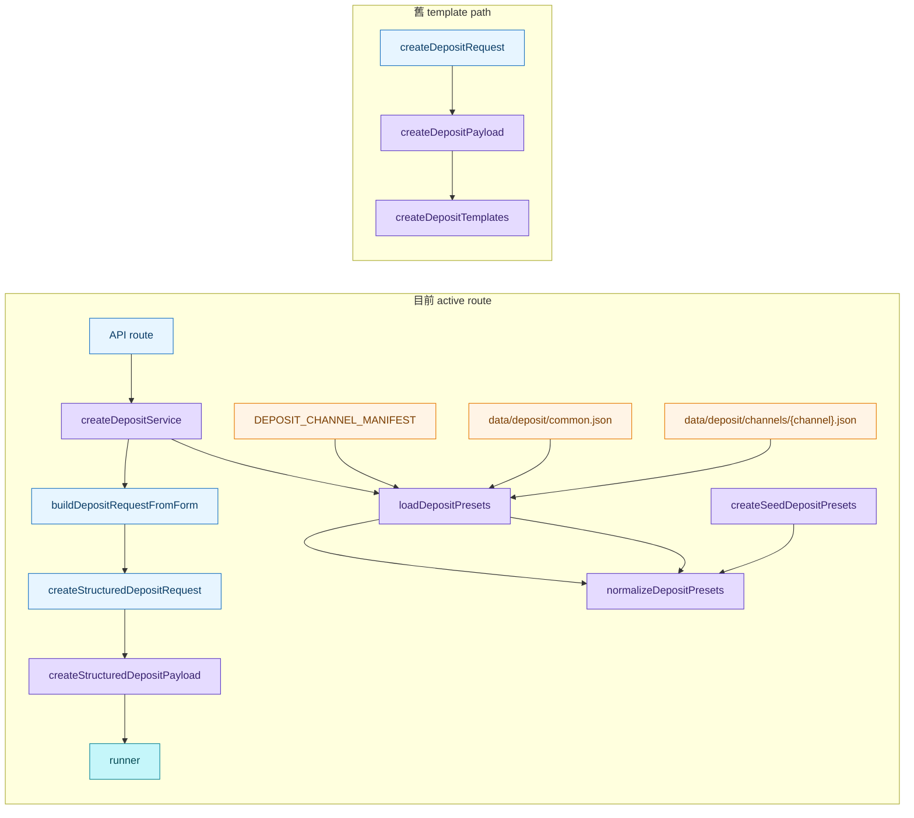
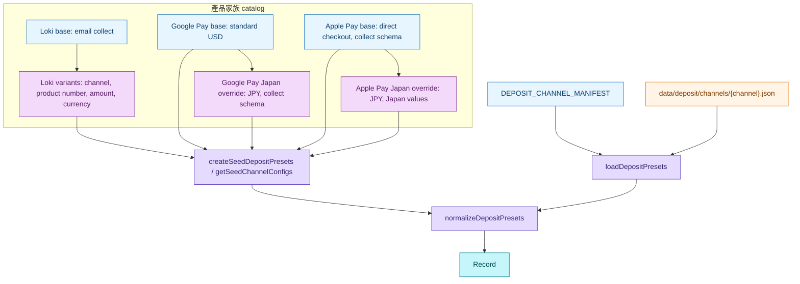

🥷 # Loki 產品家族與地區變體收斂設計書

## 文件定位

- 文件等級：完整開發設計書。
- 文件狀態：實作完成。
- 文件日期：2026-11-17。
- 主要規範：[AGENTS.md](../../AGENTS.md)。
- 設計文件規範：[ai_design_doc_writing.md](../ai_design_doc_writing.md)。
- 本文件不授權直接實作。完成確認前，不修改本設計所描述的 production runtime。

本設計處理三個 Deposit 產品家族：Loki 國際信用卡、Google Pay、Apple Pay。每個家族包含多個地區或幣別變體。變體保留既有 `channel`、preset 檔案與 UI label。runtime 內部改用產品家族定義產生共用 seed 設定。

## ASD-STE100 語句規則

ASD-STE100 主要用於英文技術文件。本文件以相同的受控技術寫作原則撰寫中文內容。

- 一個句子只描述一個主要行為。
- 每個技術概念使用固定名稱。
- 文件使用實際的模組名稱、檔案路徑與 API identifier。
- 文件使用「必須」表示要求，使用「不得」表示禁止，使用「可以」表示允許。
- 文件不使用未定義的代名詞。文件會直接寫出執行行為的元件。
- 文件不使用隱喻、宣傳語句與模糊的程度詞。
- 文件區分目前行為、建議行為、假設與未確認事項。

本文件不是 ASD-STE100 認證文件。文件只採用可由本專案現況檢查的受控寫作原則。

## 背景與問題

目前的產品變體有三個資料來源：

1. `src/core/env.ts` 的 `DEPOSIT_CHANNEL_MANIFEST` 定義 channel identity、preset 檔名、audit target 與 merchant token 類別。
2. `src/deposit/presets.ts` 的 `getSeedChannelConfigs` 以大型物件逐一定義 channel seed config。
3. `data/deposit/channels/*.json` 保存每個 channel 的可編輯 preset 值。

目前的 `getSeedChannelConfigs` 以 channel 為主要組織方式。相同產品的共用 schema 與 payload 值會在多個變體中重複。維護者修改共用規則時，必須檢查多個區塊。

Phase 0 的測試收斂已移除重複的地區案例，但 Apple Pay Japan 的三個保護案例目前只在 `collect` 內斷言 `product_name`。這些案例仍檢查 product number、JPY、amount 與 direct checkout，因此問題不是完全沒有驗證，而是沒有完整保護 Japan 的 `telephone_number` 契約。Phase 0 在補回 `telephone_number` 的精確值並重新執行適用 gate 前，不得宣稱已完整保留這項已知回歸風險。

目前 runtime 還有一條舊的 template 路徑。`src/domains/deposit.ts` 匯出 `createDepositTemplates`、`createDepositPayload` 與 `createDepositRequest`。目前 repo 內的 deposit route 使用 `createStructuredDepositRequest`。目前 repo 內沒有找到舊 template 路徑的 production caller。外部 caller 是否存在，仍未確認。

## 目標

- 以產品家族定義共用 seed config。
- 以明確的 variant override 定義地區、幣別、product number 與特殊欄位。
- 保留所有既有 Deposit channel ID。
- 保留所有既有 JSON 檔案與 JSON shape。
- 保留既有 API route、request payload、簽名規則與 error contract。
- 讓一個產品家族只需要一組共用測試，再為不同資料契約保留特殊變體測試。
- 讓 Apple Pay Japan 由特殊變體測試保護。Apple Pay Japan 的 currency、amount 與 collect values 與 USD 變體不同。
- 明確保留 Apple Pay Japan 的 `productNo=DEP-LOKI-APPLEPAYJP-JPY`、`amount=100`、`currencyCode=JPY`、`checkout_url_type=direct`、`product_name=Apple Pay Japan Test` 與 `telephone_number=+819012345678`。
- 讓後續新增地區變體只需要新增 manifest entry、JSON preset 與 variant data。

## 非目標

- 不移除或重新命名任何既有 `DepositChannel`。
- 不改變 `DEPOSIT_CHANNEL_MANIFEST` 的資料結構。
- 不修改 `data/deposit/channels/*.json` 的資料格式。
- 不新增 database、migration、repository 或 storage adapter。
- 不修改 API route path、HTTP status、response shape 或 error code。
- 不修改上游 payload key、簽名欄位、merchant token resolution 或 target environment 規則。
- 不修改 React route、page、hook 或 UI label。
- 不在本階段移除 `src/domains/deposit.ts` 的舊 template export。
- 不把所有地區變體合併成單一對外 channel。

## 設計結論

採用「產品家族基礎設定加上明確變體覆寫」的設計。

`src/deposit/presets.ts` 會保留 preset loading、seed fallback 與 normalization 責任。第一階段先在這個模組內加入產品家族 catalog。若 catalog 之後擴大到多個 feature，再抽出為獨立的 server-only module。

產品家族 catalog 只產生 seed config。Catalog 不取代 JSON preset。JSON preset 仍是每個 channel 的可編輯 runtime 值。

`DEPOSIT_CHANNEL_MANIFEST` 繼續管理 channel identity 與檔案 mapping。Manifest 不加入產品家族 schema。這樣可以避免把 UI identity、preset storage metadata 與產品 payload 規則混在一起。

`src/domains/deposit.ts` 繼續管理 domain payload 與簽名。產品家族 catalog 不直接建立 HTTP request。Route 只呼叫既有 service。

## 產品家族與變體邊界

| 產品家族 | 目前 channel 範圍 | 共用契約 | 變體差異 | 測試策略 |
| --- | --- | --- | --- | --- |
| Loki 國際信用卡 | `loki-intercard-usd`、`loki-intercard-{sg,vn,th,ph,id,hk}-usd` | `payment_order.collect.shopper_email` required | channel ID、product number、amount、currency | 一個 USD canonical case。需要驗證地區 mapping 時保留一個 regional case。 |
| Google Pay | `googlepay_usd`、`loki-googlepay-{my,sg,vn,th,ph,id,hk}-usd`、`loki-googlepay-jp-jpy` | USD 變體使用共用標準設定 | Japan 使用 JPY、不同 amount、不同 product number 與完整 collect schema | 一個 USD canonical case 加一個 Japan special case。 |
| Apple Pay | `loki-applepay-usd`、`loki-applepay-{my,ph,sg,th,vn,hk,id}-usd`、`loki-applepay-jp-jpy` | 共用 `APPLEPAY_SCHEMA`、`checkout_url_type=direct`、`product_detail`、`shopper_reference`、`shopper_email` 與 `origin` | Japan 使用 JPY、不同 amount、不同 product number、telephone number 與 product name。Japan 繼承共用 schema，不建立重複 schema。 | 一個 USD canonical case 加一個 Japan special case。 |

`loki-intercard-*`、`loki-googlepay-*` 與 `loki-applepay-*` 的 channel ID 必須保留。不同地區的 UI label、preset 檔案與外部 caller 可能依賴這些 ID。

`international_credit_cards` 是現有的另一個 channel。`international_credit_cards` 不納入本次 Loki 產品家族 catalog。

### 代表 preset data

以下資料來自目前的 channel JSON。表格只列出能代表共用契約或特殊變體的檔案。

| Preset file | Product number | Amount | Currency | Schema 或 values 特徵 |
| --- | --- | --- | --- | --- |
| `loki-intercard-usd.json` | `DEP-LOKI-INTERCARDMY-USD` | `10.00` | `USD` | 只有 required `shopper_email` |
| `googlepay_usd.json` | `DEP-LOKI-GOOGLEPAY-USD` | `10.00` | `USD` | `schema` 與 `values` 為空物件 |
| `loki-googlepay-jp-jpy.json` | `DEP-LOKI-GOOGLEPAYJP-JPY` | `100` | `JPY` | 包含完整 collect 欄位 |
| `loki-applepay-usd.json` | `DEP-LOKI-APPLEPAY-USD` | `10.00` | `USD` | `checkout_url_type=direct` 與完整 collect 欄位 |
| `loki-applepay-jp-jpy.json` | `DEP-LOKI-APPLEPAYJP-JPY` | `100` | `JPY` | `checkout_url_type=direct` 與 Japan collect values |

其餘 USD regional preset 應保持同一產品家族契約。Product number、channel ID 與 sample values 仍以各自 JSON 為準。

## 目前資料流

目前 active route 與舊 template path 如下：

現有 preset 合併規則必須保留：

- `channel JSON.commonValues` 已提供的欄位優先，缺少的 `productNo`、`amount` 與 `currencyCode` 欄位由 family seed 個別補足。
- `channel JSON.schema` 存在時，整個 source schema 優先於 family seed schema，不進行 schema 的 nested merge。
- `channel JSON.values` 存在時，整個 source values 優先於 family seed values，不進行 nested values 的 fallback 或 deep merge。
- `loadDepositPresets` 會先驗證 channel projection。缺少頂層 `commonValues`、`schema` 或 `values` 時，應回傳既有 preset storage validation error，不應被描述成由 seed 補足。
- operation input 仍由既有 `createPresetBackedService` 流程合併到 defaults。
- domain 仍由 `createStructuredDepositRequest` 產生 request。

舊 template 路徑不是第一階段的重構目標。第一階段完成後，必須再次確認外部 caller，再決定移除、deprecate 或改用 family catalog。

## 目標架構

### 產品家族 catalog

Catalog 必須由三層資料組成：

- family base：保存同一產品家族的共用 `schema` 與 `values`。
- variant identity：保存既有 channel ID 與 preset file mapping 所需的 variant key。
- variant override：只保存與 family base 不同的 `commonValues`、schema 或 values。Catalog composition 可以在 seed layer 合併 family base 與 variant override，產生完整的 `DepositChannelConfig`；這個 composition 不得改變 JSON source 的既有 normalization 語意。

Catalog composer 必須在 seed layer 明確定義巢狀 values 的組合順序。不得使用只合併第一層的 spread，也不得依賴 `normalizeDepositPresets` 替 catalog 做 deep merge。對 Apple Pay family，組合順序固定如下：

1. 深度複製 family base 的 `values`。
2. 在 top-level 合併 variant 的 scalar override，例如 `checkout_url_type`。
3. 合併 `payment_order` object，保留 family base 的其他欄位。
4. 合併 `payment_order.collect` object，保留 `product_detail`、`shopper_reference`、`shopper_email` 與 `origin`，再以 variant 的 `product_name` 與 `telephone_number` 覆寫對應欄位。
5. 對每個 variant 輸出新的 `values`、`payment_order` 與 `collect` object。不得把 family base 的 nested object reference 直接放入多個 channel config。

這個 composition contract 只適用於 seed catalog。JSON source 仍依既有 whole-field precedence 進入 `normalizeDepositPresets`，兩者不得混為同一個 merge layer。

產品家族 catalog 產生 seed config 的關係如下：

圖中的 family catalog 只產生 seed config。JSON preset 仍保存 persistent channel values。`normalizeDepositPresets` 仍保留 JSON source 優先於 family seed 的規則。

Catalog 產生的結果必須符合 `Record<DepositChannel, DepositChannelConfig>`。`getSeedChannelConfigs` 只負責組合 catalog 結果與仍未納入家族 catalog 的既有 channel seed config。

第一階段的建議實作位置是 `src/deposit/presets.ts`。這個位置已經負責 seed config 與 normalization。這個選擇可以減少 module boundary 變更。

### Loki 國際信用卡 family

Family base 使用 email collect schema。Family base 提供 `shopper_email` 的 required 欄位。

每個 variant 只提供 channel-specific product number、amount 與 currency。現有資料中的 USD 變體保持 `USD` 與 `10.00`。Variant override 不得複製完整 schema。

### Google Pay family

Google Pay USD 變體使用共用標準設定。現有 USD JSON 的 schema 與 values 為空物件。Catalog 必須保留這個資料契約。

Google Pay Japan 是 special variant。Japan variant 必須保留 JPY、Japan product number 與完整 collect schema。Japan variant 不得被 USD family base 的空 schema 覆蓋。

### Apple Pay family

Apple Pay family 使用共用 `APPLEPAY_SCHEMA`。Family base 必須保留 `checkout_url_type=direct` 與 collect 欄位。Family base 的共用 collect values 是 `product_detail`、`shopper_reference`、`shopper_email` 與 `origin`。`product_name` 與 `telephone_number` 是 variant-specific values。

Apple Pay Japan 是 special variant。Japan variant 必須繼承 `APPLEPAY_SCHEMA`，只覆寫 Japan 的 common values 與 variant-specific values。Japan variant 必須保留以下完整契約：

| Field | Required value |
| --- | --- |
| `productNo` | `DEP-LOKI-APPLEPAYJP-JPY` |
| `amount` | `100` |
| `currencyCode` | `JPY` |
| `checkout_url_type` | `direct` |
| `product_name` | `Apple Pay Japan Test` |
| `telephone_number` | `+819012345678` |

Apple Pay USD 與各 USD regional variant 也必須使用相同的 nested composition contract。每個 variant 只能覆寫自己的 product name、telephone number、product number、amount 與 currency，不得因覆寫 `payment_order` 或 `collect` 而遺失 family base 的共用欄位。

Apple Pay Japan 必須單獨保留一個 special variant test。這不是對同一產品做重複測試。這個測試保護 Japan 的不同資料契約。

## 來源、責任與優先順序

| 資料 | 主要來源 | 責任 | 本階段行為 |
| --- | --- | --- | --- |
| channel identity | `src/core/env.ts` | 定義有效 channel、preset file、audit target、token key | 不變 |
| family seed config | `src/deposit/presets.ts` 的 catalog | 提供共用 schema、values 與缺省 common values | 新增 family composition |
| persistent channel values | `data/deposit/channels/*.json` | 保存可編輯的 channel preset | 不變 |
| common values | `data/deposit/common.json` | 保存 deposit common preset | 不變 |
| normalized preset | `normalizeDepositPresets` | 合併 JSON source 與 family seed | 保留現有優先順序 |
| request payload | `src/domains/deposit.ts` | 組裝 payload 與簽名 | 不變 |
| HTTP boundary | `src/server/routes/deposit.ts` | 解析 request、呼叫 service、回傳 response | 不變 |
| UI label | `web/pages/helper/depositChannelLabels.ts` | 顯示每個 channel 的名稱 | 保留每個地區 label |

Family catalog 不得讀取 HTTP request。Family catalog 不得產生 merchant reference。Family catalog 不得決定 target environment。這些責任仍由既有 service、domain 與 env boundary 管理。

## 變更前後行為

| 面向 | 目前行為 | 目標行為 | 相容策略 |
| --- | --- | --- | --- |
| Seed config | `getSeedChannelConfigs` 逐一列出多個相似 variant | Family base 加上 variant override 產生相同 config | 保留回傳型別與 channel key |
| JSON preset | 每個 channel 讀取自己的 JSON | 每個 channel 繼續讀取自己的 JSON | 不修改 JSON shape |
| Preset normalization | `commonValues` 個別 fallback；`schema` 與 `values` 以 source whole-field precedence 處理；projection 不完整時先 validation error | 使用相同的 fallback、whole-field precedence 與 validation 行為 | 不修改 `normalizeDepositPresets` 的 source-first 規則 |
| Channel ID | Manifest 與 JSON file 使用既有 channel ID | 使用相同 channel ID | 不移除、不重新命名 |
| API defaults | 回傳既有 defaults response | 回傳相同 response | 不新增 API 欄位 |
| Request payload | `createStructuredDepositRequest` 建立 payload | 仍由相同 domain path 建立 payload | 不改變 upstream contract |
| UI label | 每個 region 有獨立 label | 每個 region 繼續有獨立 label | 不合併 label test |
| 測試 | 多個 region 反覆驗證相同欄位 | 每個 family 保留 canonical case，特殊資料保留 special case | 以 product contract 收斂測試 |
| 舊 template export | 舊 export 保留 | 第一階段仍保留 | 外部 caller 確認後另立 cleanup change |

本次 runtime 重構預期不改變 API 可觀察行為。若實作發現 request payload、defaults response、錯誤行為或 data precedence 改變，必須停止受影響的實作路徑，先更新設計並取得確認。

## 測試收斂方案

目前已完成的測試收斂如下：

- `src/server/routes/deposit.test.ts` 保留 Loki 國際信用卡 USD、Google Pay USD、Google Pay Japan、Apple Pay USD 與 Apple Pay Japan。
- `src/deposit/web.test.ts` 保留 Loki representative variant、Google Pay Japan、Apple Pay USD 與 Apple Pay Japan。
- `web/pages/DepositPage.test.tsx` 的 channel label mapping 仍保留所有 channel。Label 是每個 channel 的公開 UI contract。

未來實作 family catalog 時，不得重新加入每個地區一組完整 API flow test。需要增加測試時，優先增加一個 family catalog invariant test。該測試應檢查共用欄位與 variant override。測試不應逐一複製每個 API response assertion。

Apple Pay Japan 不會被合併到 Apple Pay USD test。Apple Pay Japan 的 JPY 與 collect values 會造成不同的 payload risk。因此 Apple Pay Japan 保留一個 special variant test。

### Phase 0 contract correction

目前三個 Apple Pay Japan 相關案例都沒有精確斷言 `telephone_number`。Phase 0 的補正只需要在既有案例加入以下斷言，不需要恢復已刪除的地區重複測試：

| Test layer | File and case | Required assertion | Protected risk |
| --- | --- | --- | --- |
| Seed preset | `src/deposit/web.test.ts`，Apple Pay Japan seed case | `result.channels['loki-applepay-jp-jpy'].values.payment_order.collect.telephone_number === '+819012345678'` | family seed 沒有移除 Japan phone，或沒有誤用 USD phone |
| Request builder | `src/deposit/web.test.ts`，Apple Pay Japan request case | `payload.payment_order.collect.telephone_number === '+819012345678'` | request payload 沒有遺失或改寫 Japan phone |
| API defaults | `src/server/routes/deposit.test.ts`，Apple Pay Japan defaults case | `form.channelValues.payment_order.collect.telephone_number === '+819012345678'` | defaults boundary 沒有遺失 Japan phone |

三個案例仍應保留既有的 product number、JPY、amount、direct checkout 與 product name 斷言。API defaults case 若同時保護 schema contract，也應確認 `telephone_number` 欄位仍為 required。這三個 assertion 的期望值必須相同，且必須使用 exact value，不得只檢查欄位存在或使用空字串以外的寬鬆條件。

Phase 0 的補正完成條件是三個 assertion 都已加入，且 `bun run test:api`、`tsc --noEmit` 與 `git diff --check` 重新通過。完成前，文件中的 Phase 0 狀態必須維持「需補正」。

### Phase 1 catalog and invariant tests

Phase 1 的主要驗收證據是 family catalog invariant tests、JSON precedence tests，以及既有 API boundary tests。測試必須保護 channel set、family representative、特殊變體 contract、nested composition 與既有 normalization 行為。

歷史上，baseline `1ddc22b529765da1e388ea80fcf3b885ce0fa835` 與 Phase 1
candidate `48cc6f25cf9ede407184a82c6f0f75a9ea4ccde0` 曾使用相同的
`.env.test`、`data/deposit` source 與固定 `makeId` 比較 canonicalized seed
store 和 normalized store，兩組輸出均為 zero byte diff。這段結果只作為
一次性歷史證據，不是目前 branch HEAD 的永久 gate；完整歷史紀錄見
[`2026-11-17-loki-product-family-variants-parity.md`](../review/2026-11-17-loki-product-family-variants-parity.md)。

Catalog layer 必須另外保留最低必要的 invariant test：

- `Object.keys(seed.channels)` 與 `DEPOSIT_CHANNELS` 的 channel set 完全相同。
- Loki intercard USD、Google Pay USD 與 Apple Pay USD 各保留一個 family representative，驗證各自的 common values 與 family contract。
- Google Pay USD 的 schema 與 values 保持空物件。
- Apple Pay USD 保持 `checkout_url_type=direct` 與共用 collect fields。
- Apple Pay Japan 明確驗證 `DEP-LOKI-APPLEPAYJP-JPY`、`amount=100`、`currencyCode=JPY`、`checkout_url_type=direct`、`product_name=Apple Pay Japan Test`、`telephone_number=+819012345678` 與共用 collect fields。
- Apple Pay sibling isolation 以行為驗證：修改 `loki-applepay-usd` 的 nested value 後，`loki-applepay-my-usd` 與 `loki-applepay-jp-jpy` 的對應值仍保持不變。Catalog test 不逐層斷言 object reference identity。
- Google Pay Japan 的 JPY 與 collect contract 由既有 request／API boundary test 保護，不在 catalog test 重複逐欄位斷言。

JSON precedence test 必須反映目前 normalization contract，而不是引入 nested merge：

- source 只提供部分 `commonValues` 時，已提供欄位保留，缺少的 common 欄位由 family seed 補足。
- source 提供 `schema` 時，整個 source schema 優先於 family schema。
- source 提供 `values` 時，整個 source values 優先於 family values。缺少 nested values 不由 family seed 補足。
- 若直接測試 `loadDepositPresets`，JSON projection 必須包含既有 validation 所需的頂層欄位。故意缺少頂層欄位時，預期結果是 validation error，不是 seed fallback。

公開 boundary tests 保留文件指定的最低案例：API 的 Loki USD、Google Pay USD、Google Pay Japan、Apple Pay USD 與 Apple Pay Japan；request builder 的 Loki representative、Google Pay Japan、Apple Pay USD 與 Apple Pay Japan；以及所有 channel 的 UI label mapping。這些 boundary test 不應重新擴展成每個地區一組完整 API flow test。

Phase 1 diff 應主要限制在 `src/deposit/presets.ts` 與最低必要的 preset/test 檔案。若變更 `src/core/env.ts`、`src/domains/deposit.ts`、`src/server/routes/deposit.ts`、`data/deposit/**/*.json`、UI route、page 或 label，必須在實作交付中說明原因與公開行為影響。

### Risk -> Test -> Test layer

| Risk | Test | Test layer |
| --- | --- | --- |
| Family base 的 schema 或 values 遺失 | 驗證 Loki、Google Pay USD、Apple Pay USD 的 canonical defaults 與 request payload | preset、domain、API boundary |
| Google Pay Japan 被錯誤套用 USD 空 schema | 驗證 Japan 的 JPY、product number 與 collect schema | preset、API boundary |
| Apple Pay Japan 被錯誤套用 USD 變體 | 驗證 `DEP-LOKI-APPLEPAYJP-JPY`、JPY、amount `100`、product name、telephone number `+819012345678` 與 direct checkout | preset、web request boundary、API boundary |
| Catalog 的 shallow merge 遺失 Apple Pay 共用 collect 欄位 | 驗證 variant 覆寫 `product_name` 與 `telephone_number` 後仍保留 `product_detail`、`shopper_reference`、`shopper_email` 與 `origin` | preset/catalog layer |
| Catalog sibling values 互相污染 | 修改一個 Apple Pay variant 的 nested value，確認 regional sibling 與 Japan sibling 的對應值不變 | preset/catalog layer |
| Variant channel ID 與 preset file mapping 變更 | 驗證 manifest channel 與 preset loader 的 mapping | preset/config layer |
| JSON source 優先順序或 fallback 語意改變 | 使用 partial `commonValues`、whole-field schema 與 whole-field values source override 的 normalization case；另驗證不完整 JSON projection 仍回傳 validation error | preset/service layer |
| 既有必填欄位或邊界驗證回歸 | 沿用目前 validation 與 API negative cases | validation/API boundary |
| UI label 被錯誤合併 | 保留全部 channel label mapping test | frontend boundary |
| 舊 template export 被不相容地移除 | 在 cleanup phase 先完成 repo search 與外部 caller 確認，再增加相容性 test | domain/API contract |

同一個 family contract 預設只在一個最低合適層級驗證。API、web request 與 UI label 只有在它們具有不同公開 contract 時才保留 boundary test。

## 實作分期

### Phase 0：測試收斂，已完成

Phase 0 已合併重複的地區測試，也沒有改變 production runtime。Apple Pay Japan 的三個 special cases 已補回 `telephone_number` 的精確斷言，特殊資料契約的風險保留已完成。

Phase 0 的測試保留 canonical product cases 與 special variant cases。`telephone_number=+819012345678` 的 seed、request payload 與 API defaults assertion 已加入，且適用的 API test、型別檢查與 diff gate 已通過。

### Phase 1：建立 family catalog，已完成實作

Phase 1 只修改 seed config 的組織方式。Phase 1 不修改 JSON、manifest、API route、domain payload 或 UI。

Phase 1 必須完成以下事項：

- 在 `src/deposit/presets.ts` 建立 Loki、Google Pay、Apple Pay 的 family base 與 variant override 定義。
- 讓 `getSeedChannelConfigs` 使用 family catalog 產生對應 channel config。
- 保留非 Loki family 的既有 seed config。
- 保留 JSON source 的既有 normalization 規則：`commonValues` 個別 fallback，`schema` 與 `values` whole-field source precedence，不新增 nested merge。
- 保留所有 current channel ID 與 preset file mapping。
- 先補正 Phase 0 的 Apple Pay Japan `telephone_number` assertion。
- 更新或新增最低必要的 catalog invariant test。
- Catalog composer 在 seed layer 明確合併 Apple Pay 的 `values`、`payment_order` 與 `collect`，不得使用只合併第一層的 spread，也不得依賴 normalization deep merge。
- Catalog composer 對每個輸出的 `DepositChannelConfig` 使用 deep clone，避免 sibling variants 共用 schema、values 或 nested object reference。
- 完成 JSON precedence 與不完整 projection validation 的測試。
- 確認 diff 沒有超出 preset、測試與必要文件範圍。
- 執行適用的 API test、型別檢查與 API build gate。

Phase 1 沒有 database migration。Phase 1 沒有 deployment flag。Phase 1 可以透過 revert code change 回復。JSON data 不需要回復。

### Phase 2：舊 template path decision，另案處理

Phase 2 不是 Phase 1 的必要工作。Phase 2 必須先確認 `src/domains/deposit.ts` 的舊 template export 是否有 repo 外 caller。

確認結果可以導向以下其中一個方案：

- 保留舊 export，並標記 deprecate。
- 將舊 export 改用相同的 family catalog，但維持既有 public contract。
- 在確認沒有 caller 且完成 migration 後移除舊 export。

Phase 2 需要獨立設計與獨立驗證。Phase 2 不得在 Phase 1 中順便刪除舊 export。

## 受影響檔案與不變檔案

| 檔案或目錄 | Phase 1 狀態 | 原因 |
| --- | --- | --- |
| `src/deposit/presets.ts` | 修改 | 建立 family catalog，重組 seed config |
| `src/core/env.ts` | 不修改 | 保留 channel identity 與 manifest contract |
| `src/domains/deposit.ts` | 不修改 | 保留 payload、簽名與 legacy export contract |
| `src/deposit/service.ts` | 不修改 | 保留 preset-backed service flow |
| `src/server/routes/deposit.ts` | 不修改 | 保留 HTTP boundary |
| `data/deposit/common.json` | 不修改 | 保留 common preset data |
| `data/deposit/channels/*.json` | 不修改 | 保留 per-channel persistent data |
| `src/server/routes/deposit.test.ts` | 保留並補強已收斂案例 | 驗證 API defaults 與 request contract，包含 Apple Pay Japan telephone number |
| `src/deposit/web.test.ts` | 保留並補強已收斂案例 | 驗證 seed preset 與 request builder contract，包含 Apple Pay Japan telephone number |
| `web/pages/helper/depositChannelLabels.ts` | 不修改 | 地區 label 是獨立 UI contract |
| `web/pages/DepositPage.test.tsx` | 不刪除全部 label cases | 需要保護所有 public label mapping |

## API、資料與錯誤邊界

Phase 1 不新增 API。既有 route 仍負責 HTTP parsing、service dispatch 與錯誤轉換。

Phase 1 不新增資料庫寫入。既有 JSON loader 與 writer 不變。

Phase 1 不新增 error code。preset JSON 無法讀取、validation 失敗、upstream error 與 internal error 仍走既有 error boundary。

Family catalog 建立錯誤屬於 server configuration error。Catalog 必須在建立 seed config 時暴露明確的 channel 或 variant identifier。錯誤訊息不得包含 secret、merchant token 或完整 request payload。

## 部署、回復與相容性

- 不新增環境變數。
- 不新增 token 或 API key。
- 不需要先部署 backend 或 frontend。
- 不需要 data migration。
- 不需要修改既有 channel JSON。
- 既有 API caller 可以繼續使用原本的 channel ID。
- 既有 UI 可以繼續顯示原本的 region label。
- 失敗時可以 revert Phase 1 的 server code。既有 JSON data 不需要回復。
- 若未來要改變 channel ID、JSON shape 或 API contract，必須另立設計並取得確認。

本設計不建立 feature flag。現有專案沒有為本次 seed catalog 提供獨立 feature flag 的需求。

## 完成定義

Phase 1 完成時，必須滿足以下條件：

- Phase 0 的 Apple Pay Japan 三個相關 assertion 已補回 `telephone_number=+819012345678`，且適用測試重新通過。
- Family base 與 variant override 已在指定模組中定義。
- `getSeedChannelConfigs` 不再重複保存相同 family schema 與 values。
- 所有既有 Loki、Google Pay 與 Apple Pay channel ID 都仍可載入。
- 所有既有 JSON preset 都能被正常 normalize。
- Loki、Google Pay USD、Google Pay Japan、Apple Pay USD 與 Apple Pay Japan 的代表性 defaults 與 request contract 不變。
- Apple Pay Japan 的 special variant 覆寫仍有效。
- Apple Pay variant 的 nested composition 保留所有 family base collect fields，variant override 只改變指定欄位。
- Catalog invariant test 證明 channel set、三個 family representative、Apple Pay Japan 特殊值與 sibling nested value isolation 完整保留；JSON mapping 仍由既有 manifest／preset loader contract 保護。
- JSON precedence test 證明 partial `commonValues` fallback、whole-field schema precedence、whole-field values precedence 與 projection validation 行為不變。
- UI label mapping 不變。
- 沒有 API、database、migration 或 upstream payload contract 變更。
- `bun run test:api` 通過。
- `tsc --noEmit` 通過。
- `bun run build:api` 通過。
- `git diff --check` 通過。
- `bun run test:db` 不屬於本階段 gate，因本設計不修改 database 或 migration。

## 驗證紀錄

以下驗證已在本設計文件建立前完成。驗證對象是 Phase 0 的測試收斂變更，不是 Phase 1 runtime 重構。

| 命令 | 結果 | 證明內容 |
| --- | --- | --- |
| `bun run test:api` | 通過。179 tests pass，0 fail | API 與 backend unit test 沒有因測試收斂而回歸 |
| `tsc --noEmit` | 通過 | TypeScript 型別檢查通過 |
| `git diff --check` | 通過 | 目前 diff 沒有 whitespace error |

上述紀錄只證明當時的測試 assertion 通過，不證明 Apple Pay Japan 的 `telephone_number` 已被完整保護。Phase 0 補正與 Phase 1 實作後，必須重新執行 `bun run test:api`、`tsc --noEmit`、`bun run build:api` 與 `git diff --check`。文件更新本身不需要執行 frontend 或 database gate。`bun run test:db` 仍由使用者或 CI 執行。Phase 1 不預期需要該 gate。

## 已確認、假設與待確認事項

### 已確認

- 產品家族的地區變體共用主要產品契約。
- 不需要為每個相同產品變體建立完整重複的 API flow test。
- Google Pay Japan 與 Apple Pay Japan 具有不同的資料契約，因此各保留一個 special variant test。
- Apple Pay Japan 的 special contract 包含 `DEP-LOKI-APPLEPAYJP-JPY`、`amount=100`、`currencyCode=JPY`、`checkout_url_type=direct`、`product_name=Apple Pay Japan Test` 與 `telephone_number=+819012345678`。
- 地區 channel ID、JSON file 與 UI label 必須保留。
- 目前 active route 使用 structured request path。
- `normalizeDepositPresets` 不對 nested `values` 做 deep merge。`commonValues` 只做已知欄位的個別 fallback，`schema` 與 `values` 使用 source whole-field precedence。

### 設計假設

- `data/deposit/channels/*.json` 是可編輯的 persistent channel state。
- Family catalog 只作 seed fallback 與 invariant source。
- 目前 repo 以外沒有依賴舊 template export，或 Phase 2 會先完成 caller 確認。

### 待確認事項

| 事項 | 是否阻塞 Phase 1 | 預設建議 |
| --- | --- | --- |
| `createDepositTemplates`、`createDepositPayload`、`createDepositRequest` 是否有 repo 外 caller | 否。只阻塞 Phase 2 cleanup | Phase 1 不刪除 export。先完成外部 caller audit。 |
| Family catalog 放在 `src/deposit/presets.ts` 或新的 internal module | 否 | Phase 1 先放在 `src/deposit/presets.ts`。catalog 變大後再抽 module。 |
| 是否新增一個 catalog invariant test | 否 | Phase 1 必須新增一個。測試 family contract、manifest mapping 與 special override，不測每個地區的完整 flow。 |

## 請求確認

請確認是否採用以下 Phase 1 設計：

1. 使用產品家族 base 加上明確 variant override。
2. 保留所有 channel ID、JSON preset、manifest、API contract 與 UI label。
3. 只重構 `src/deposit/presets.ts` 的 seed config 組織方式。
4. 保留 Loki、Google Pay、Apple Pay 的 canonical cases。
5. 保留 Google Pay Japan 與 Apple Pay Japan 的 special variant cases。
6. 將 JSON precedence 定義為 partial `commonValues` fallback、whole-field schema precedence 與 whole-field values precedence，不在 Phase 1 新增 nested merge。
7. 將舊 template path cleanup 延後到獨立 Phase 2。

完成確認後，才開始 Phase 1 的 production code 實作。

## 依據來源

| 來源 | 用途 |
| --- | --- |
| [AGENTS.md](../../AGENTS.md) | 專案分層、設計文件政策、測試與驗證 gate |
| [ai_design_doc_writing.md](../ai_design_doc_writing.md) | 完整設計書分流、確認流程與完成條件 |
| [ai_reference.md](../ai_reference.md) | preset、domain、API、相容性、測試與 Risk -> Test -> Test layer 章節要求 |
| `src/core/env.ts` | channel manifest 與 channel file mapping |
| `src/deposit/presets.ts` | seed config、preset loading、normalization |
| `src/deposit/service.ts` | active deposit service flow |
| `src/server/routes/deposit.ts` | active deposit HTTP route |
| `src/deposit/web.ts` | structured request builder boundary |
| `src/domains/deposit.ts` | structured payload、簽名與 legacy template exports |
| `data/deposit/channels/*.json` | Loki、Google Pay、Apple Pay 的現有 preset shape |
| `src/server/routes/deposit.test.ts` | API 代表性產品案例 |
| `src/deposit/web.test.ts` | web preset 與 request builder 代表性案例 |
| `web/pages/helper/depositChannelLabels.ts`、`web/pages/DepositPage.test.tsx` | 每個 channel 的 UI label contract |
